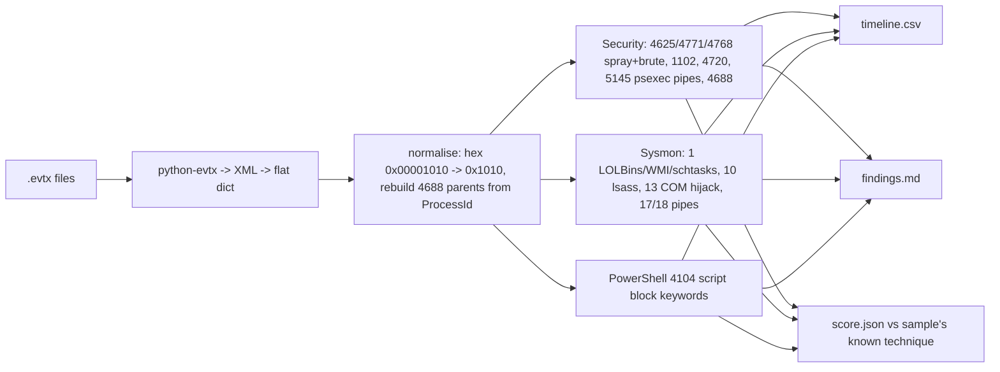

# evtx-triage: Windows event log triage on public attack samples

> **Lab project.** It runs on public EVTX files from **EVTX-ATTACK-SAMPLES by Samir Bousseaden (GPL-3.0)**. The files are downloaded by `samples/fetch.sh` and not redistributed. SHA-256 hashes are in `results/samples_SHA256SUMS.txt`. Unit tests use hand-built XML events, so CI runs offline.

## Problem
In an incident, an analyst gets `.evtx` files from a host and has to answer *what happened, when, and which technique* before anything else. Opening Event Viewer and scrolling isn't triage. evtx-triage parses Security, Sysmon and PowerShell logs, runs 14 rules mapped to MITRE ATT&CK, and writes a **timeline CSV and a findings report**. It's scored against the technique each public sample is known to contain.

## Architecture


## Run
```bash
pip install -r requirements-dev.txt
pytest -q
sh samples/fetch.sh
python -m evtxtriage.cli samples/*.evtx -o results
docker build -t evtx-triage . && docker run --rm -v $PWD/samples:/s evtx-triage /s/DE_1102_security_log_cleared.evtx -o /s/out
```

## Results (actual runs, 2026-10-11, 11 public samples, 203 records)
| Run | Sample-level hit rate | Notes |
|---|---|---|
| v1 (`results/run_v1.log`) | **7/11** | 4 misses, all caused by real-data format differences |
| v2 (`results/run.log`) | **11/11** | after the 4 fixes below. 10 attack samples flagged with the right technique, and the 1 benign logon sample has no findings |

**What the real data taught me (v1 misses):**
1. **LSASS access missed.** Sysmon writes `GrantedAccess` as `0x00001010` and my allow-list had `0x1010`. Fixed by normalising hex numerically.
2. **Kerberos spray missed.** Same zero-padding on `Status` (`0x00000018`). The sample's spray also shows up as 4768 with status `0x6` (unknown principal, i.e. user enumeration), which I hadn't counted. The fix found 9 accounts tried from 172.16.66.1.
3. **COM hijack missed.** Sysmon logs `HKU\<SID>_CLASSES\CLSID\...\InprocServer32`, not `...\Software\Classes\...`. I widened the regex.
4. **WMI lateral movement missed.** On older Windows, 4688 has no `ParentProcessName`. I rebuild the parent from `ProcessId` → `NewProcessId`, which shows `WmiPrvSE.exe → calc.exe`.

Each fix has a regression test (`test_regressions_from_real_samples`). `pytest`: 7 passed.

## Limitations
- **I tuned the v2 rules on the same 11 samples I score them on**, so 11/11 is overfit by construction. A fair test needs held-out data (other EVTX-ATTACK-SAMPLES folders, OTRF Security-Datasets).
- Scoring is at sample level ("did we flag the named technique"), not per event. There's only one benign sample, so the false-positive rate is essentially unmeasured.
- The `kerberos_pwd_spray` sample also contains a 1102 (log cleared) event, which we flag correctly but which isn't the named technique.
- No Sigma rules here. The logic is in Python. My `detection-rules-as-code` repo holds the Sigma side, and converting these rules into it is the next step.
- The Docker image was not built on this box.

## Sources
- EVTX-ATTACK-SAMPLES, Samir Bousseaden (GPL-3.0): https://github.com/sbousseaden/EVTX-ATTACK-SAMPLES
- python-evtx (Willi Ballenthin): https://github.com/williballenthin/python-evtx
- Windows Security auditing event reference (4625, 4768, 4771, 4720, 5145, 4688, 1102): https://learn.microsoft.com/en-us/windows/security/threat-protection/auditing/
- Kerberos result codes (0x6, 0x18): https://learn.microsoft.com/en-us/windows/security/threat-protection/auditing/event-4771
- Sysmon event IDs: https://learn.microsoft.com/en-us/sysinternals/downloads/sysmon
- MITRE ATT&CK T1110.003, T1003.001, T1059.001, T1070.001, T1136.002, T1569.002, T1047, T1546.015, T1218, T1053.005
